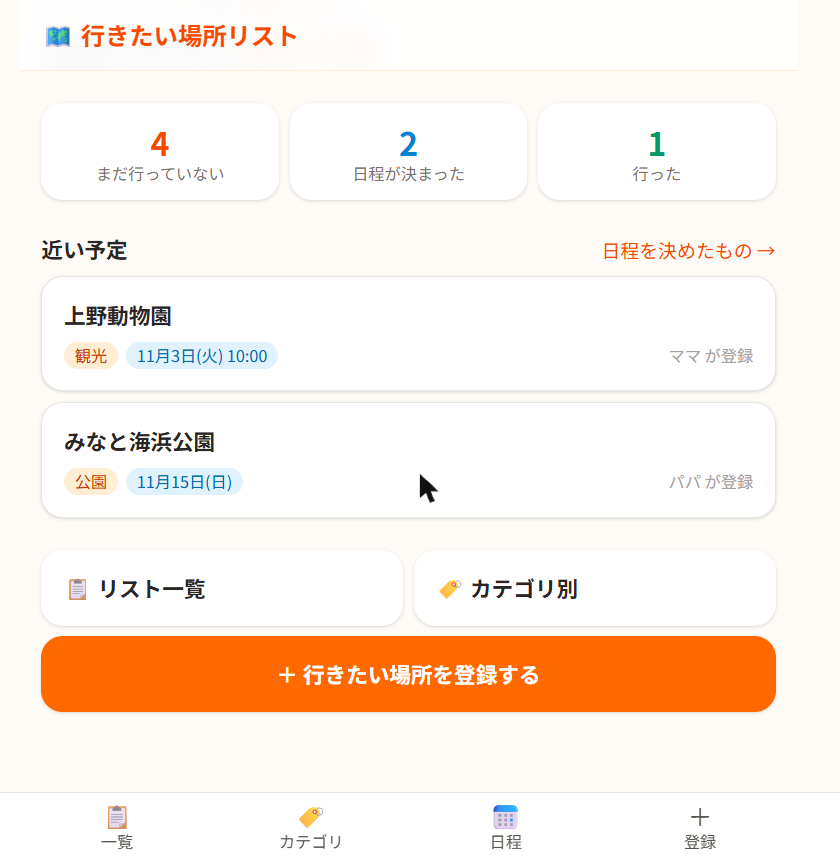
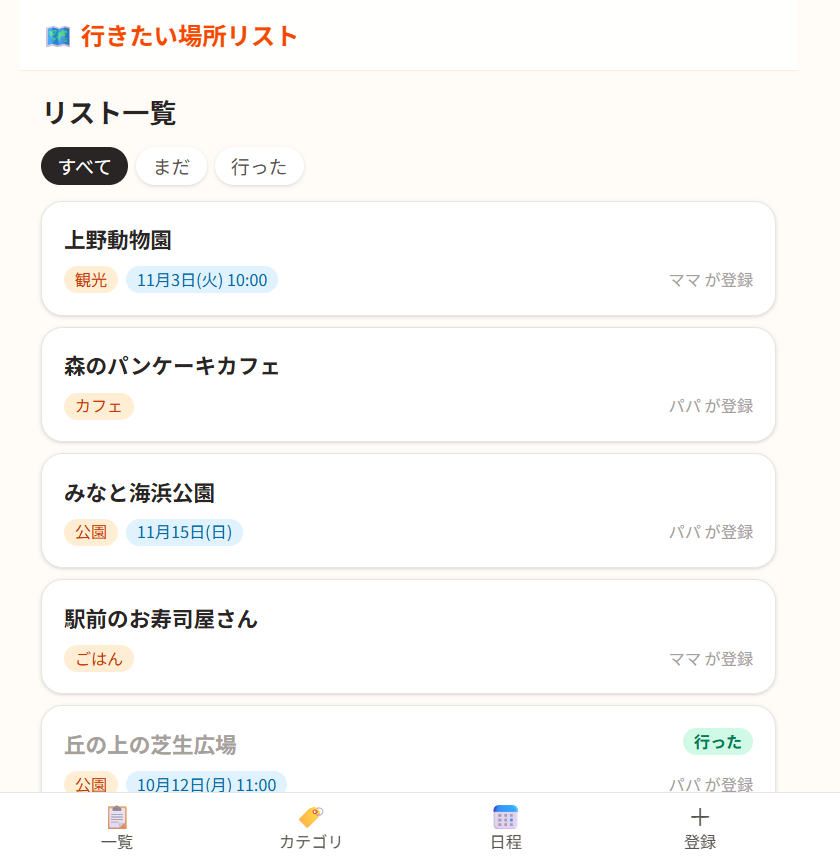
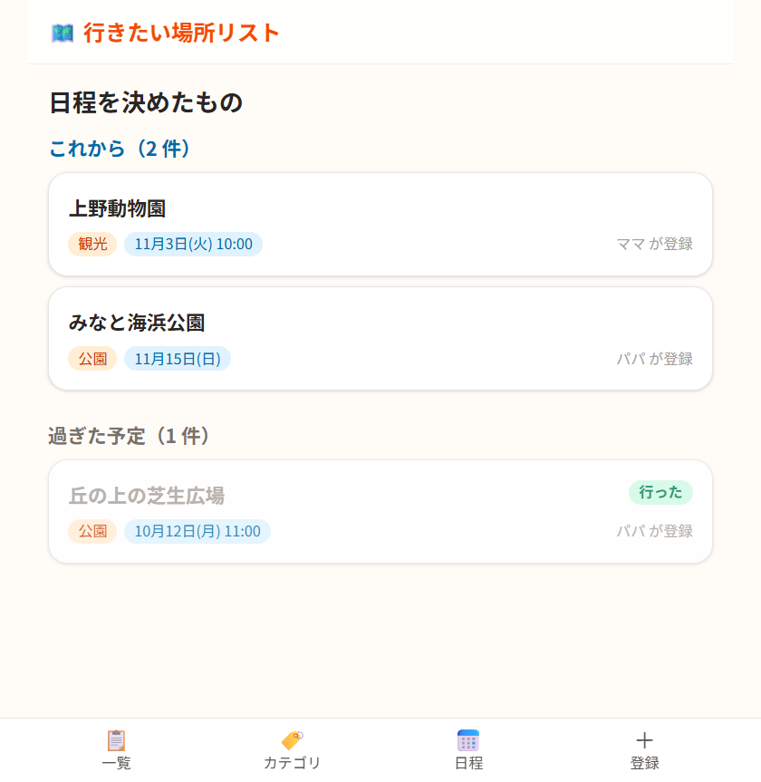
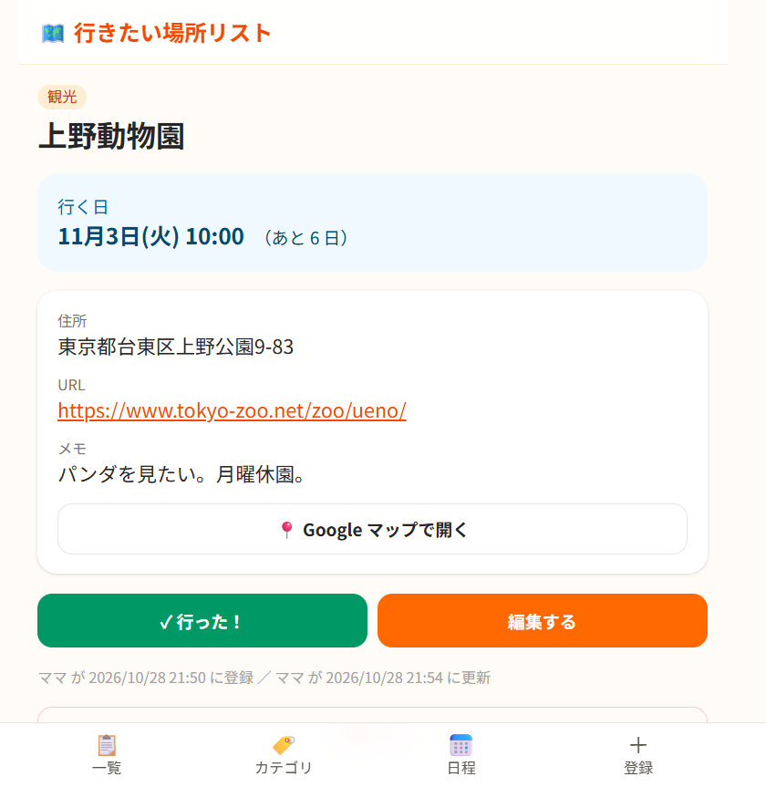

# 行きたい場所リスト

家族の「行ってみたい」を 1 か所に集めて、カテゴリで探し、行く日を決めるための Web アプリです。
SNS やメモ、地図アプリにばらばらに残していた行きたい場所を、家族みんなで同じリストにまとめます。

- 公開 URL: https://places-next-two.vercel.app （合言葉が必要です）
- 使うのは自分と家族だけなので、アカウントは作らず、家族で決めた合言葉 1 つで使います。

| トップ                               | リスト一覧                               | 日程を決めたもの                                   | 場所の詳細                                 |
| ------------------------------------ | ---------------------------------------- | -------------------------------------------------- | ------------------------------------------ |
|  |  |  |  |

※ スクリーンショットはサンプルのデータです。

## できること

- 行きたい場所の登録・編集・削除（名前・カテゴリ・住所・URL・メモ）
- リスト一覧（「まだ／行った」とカテゴリで絞り込み）・カテゴリ別の件数
- 行く日を決めると「日程を決めたもの」に近い順で並ぶ（過ぎた予定は分けて表示）
- 「行った」の印、Google マップで開くリンク
- 誰が登録・更新したかを表示（最初に入力した名前をその端末で覚える）

## 技術スタック

| 分野           | 使ったもの                                                                               |
| -------------- | ---------------------------------------------------------------------------------------- |
| フレームワーク | Next.js 16（App Router・Server Actions・Proxy・Cache Components）/ React 19 / TypeScript |
| スタイル       | Tailwind CSS 4                                                                           |
| データベース   | Supabase（Postgres。無料プラン）                                                         |
| ホスティング   | Vercel（Hobby プラン）                                                                   |
| テスト         | Vitest                                                                                   |
| 開発           | Claude Code                                                                              |

## しくみ

- **合言葉**: 正しい合言葉を入れると、合言葉から作った署名（HMAC-SHA256）を HttpOnly の Cookie に 1 年間保存します。`src/proxy.ts` がすべてのページの前で Cookie を確かめます。合言葉を変えると全員の Cookie が無効になります。
- **データ**: Supabase にはサーバー（Server Actions / Server Components）からだけ secret キーでつなぎます。テーブルは RLS をオンにしてポリシーを作っていないので、ブラウザ用のキーでは読み書きできません。
- **日付**: Vercel のサーバーは UTC で動くので、「今日」は日本時間で決めています（`src/lib/schedule.ts`）。

## 手元で動かす

```bash
npm install
cp .env.example .env.local   # 値を入れる
npm run dev                  # http://localhost:3000
npm test
```

### 環境変数

| 名前                  | 内容                                                              |
| --------------------- | ----------------------------------------------------------------- |
| `APP_PASSWORD`        | 家族の合言葉（半角英数字。iPhone のパスワード欄でも打てるように） |
| `SUPABASE_URL`        | Supabase のプロジェクトの URL                                     |
| `SUPABASE_SECRET_KEY` | Supabase の secret キー（`sb_secret_…`）。ブラウザには渡さない    |

### データベース

Supabase の SQL Editor で [`docs/schema.sql`](docs/schema.sql) を実行します。

## ドキュメント

- [要件定義書](docs/requirements.md)
